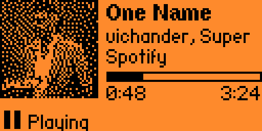
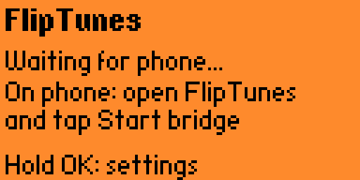
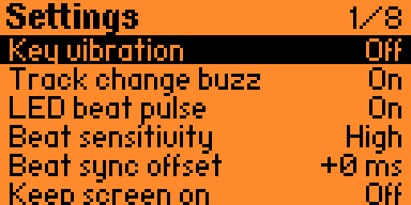
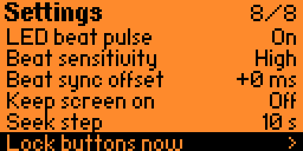
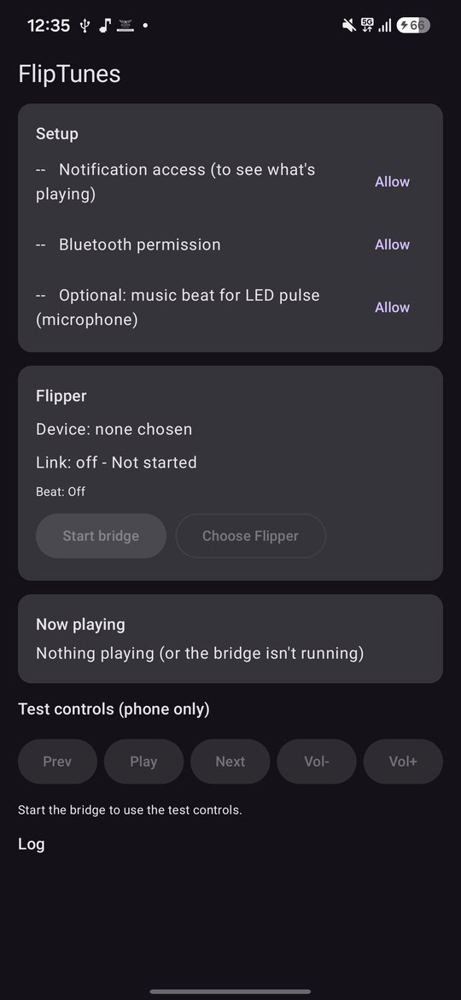
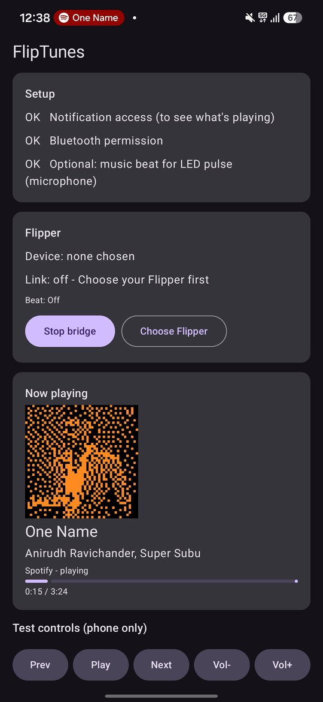
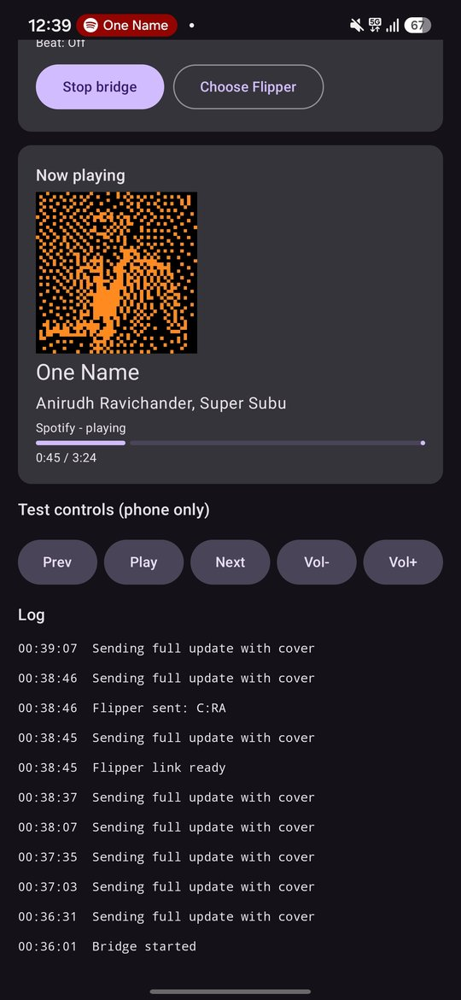
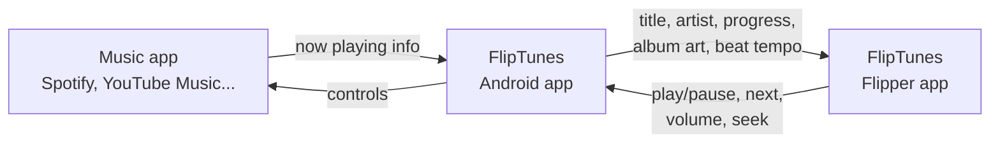

<div align="center">

# 🎵 FlipTunes

**Now Playing display and music remote with Flipper Zero**

See what's playing on your Android phone - title, artist, progress and album art -
right on your Flipper Zero, control the music from it, and watch the LED pulse to the beat.

[](https://github.com/imamjesly/fliptunes/actions/workflows/build.yml)
[](LICENSE)




</div>

## Features

- 🖼️ **Album art** - the cover, dithered to 48x48 black-and-white for the Flipper's screen
- 📝 **Song info** - title and artist (scrolling when long), player app, live progress bar
- ⏯️ **Controls** - play/pause, next/previous, volume, seek
- 💡 **LED beat pulse** - the LED flashes orange in time with the music (tempo-locked, adjustable sync)
- 📳 **Track-change buzz** - a gentle double tap when a new song starts by itself
- 🔒 **Lock mode** - screen stays on, buttons ignored: put it on your desk or in your pocket
- ⚙️ **Settings menu** - every effect can be switched on or off
- 🎧 Works with **any** music app that shows media controls (Spotify, YouTube Music, Samsung Music, podcasts...)
- 🔐 **No internet, no accounts, no tracking** - phone and Flipper talk directly over Bluetooth

## Screenshots

<table>
<tr>
<td align="center"><br><sub>Start screen</sub></td>
<td align="center"><br><sub>Settings</sub></td>
<td align="center"><br><sub>More settings</sub></td>
</tr>
</table>

<table>
<tr>
<td align="center"><br><sub>First run: allow access</sub></td>
<td align="center"><br><sub>Now playing + Flipper cover preview</sub></td>
<td align="center"><br><sub>Test controls and activity log</sub></td>
</tr>
</table>

## How it works



The Android app reads the phone's media session (the same info your lock screen shows),
and sends it to the Flipper over Bluetooth Low Energy. Button presses travel back the other way.
Read the full walkthrough in **[docs/HOW-IT-WORKS.md](docs/HOW-IT-WORKS.md)**.

## Install

You need **both** parts. Downloads are on the [Releases](https://github.com/imamjesly/fliptunes/releases) page.

### 1. Flipper Zero
1. Update your Flipper to the latest official firmware (qFlipper or [lab.flipper.net](https://lab.flipper.net)).
2. Download `fliptunes.fap` from the latest release.
3. Copy it to the SD card at `apps/Bluetooth/` (qFlipper > File manager).

### 2. Android phone (Android 12 or newer)
1. Download `FlipTunes.apk` from the latest release and open it.
   Android may ask you to allow installs from your browser/file manager.
2. Open **FlipTunes** and tap **Allow** for:
   - **Notification access** - this is how Android lets apps see what's playing. Nothing else is read.
   - **Bluetooth** - to talk to the Flipper.
   - *Optional:* **Microphone** - only used to feel the music's beat for the LED pulse.
     Android groups audio analysis under this permission. No audio is recorded or sent anywhere.

> **Note on Android's new developer verification:** Google is rolling out a requirement for
> sideloaded apps to come from verified developers (enforced in Brazil, Indonesia, Singapore and
> Thailand since September 2026, worldwide in 2027). If your phone shows a warning, Android's
> "install unverified app" option still works - it just adds a few steps and a waiting period.

### 3. Connect
1. On the Flipper: **Apps > Bluetooth > FlipTunes**.
2. On the phone: **Choose Flipper** > pick your Flipper > **Start bridge**.
3. If asked, confirm the pairing code on both devices.
4. Play some music. 🎶

> Close the official Flipper mobile app while using FlipTunes - both use the same Bluetooth link.

## Controls

| Button | Action |
|---|---|
| OK | Play / Pause |
| Hold OK | Settings |
| Left / Right | Previous / Next track |
| Hold Left / Right | Seek back / forward |
| Up / Down | Volume (hold to repeat) |
| Back | Exit |
| Hold Back | Lock / unlock buttons |

## Settings

| Setting | What it does |
|---|---|
| Key vibration | Vibrate on button presses |
| Track change buzz | Double tap when a new song starts on its own |
| LED beat pulse | Orange LED flashes to the beat |
| Beat sensitivity | Low / Medium / High - how easily beats are picked up |
| Beat sync offset | Move flashes earlier/later (-400 to +400 ms), e.g. for Bluetooth earbuds |
| Keep screen on | Display stays lit while the app is open |
| Seek step | 5 / 10 / 15 / 30 seconds |
| Lock buttons now | Lock mode (hold Back to unlock) |

## Troubleshooting

| Problem | Fix |
|---|---|
| Flipper stays on "Waiting for phone" | Check **Choose Flipper** picked the right device, the Flipper's Bluetooth is on, and the official Flipper app is closed. |
| "No art" | Some players only share a web link to the cover, not the image. Try another player. |
| LED pulse looks random or steady | The app's **Beat:** line shows the status. Some players block audio analysis; then a steady 120 BPM is used. |
| LED a bit early or late | Settings > Beat sync offset. Bluetooth earbuds usually need a positive (later) offset. |
| Song titles show `?` | The Flipper's font only has basic Latin letters. |

## Build from source

**Flipper app** ([ufbt](https://github.com/flipperdevices/flipperzero-ufbt)):
```
pip install ufbt
cd flipper
ufbt launch        # build, install and run on a connected Flipper
```

**Android app:** open the `android/` folder in Android Studio and press Run.

Every push is built automatically by GitHub Actions - see the Actions tab for test builds.

## Project layout

```
flipper/   Flipper Zero app (C, ufbt)
android/   Android app (Kotlin, Jetpack Compose)
docs/      How it works, message protocol, images
```

## Contributing

Issues and pull requests are welcome - bug reports with your phone model, music app and Flipper firmware version help a lot.

## License

[GPL-3.0](LICENSE) © Imaam Jesly

*FlipTunes is an independent project and is not affiliated with or endorsed by Flipper Devices Inc.
"Flipper Zero" is a trademark of Flipper Devices Inc.*
