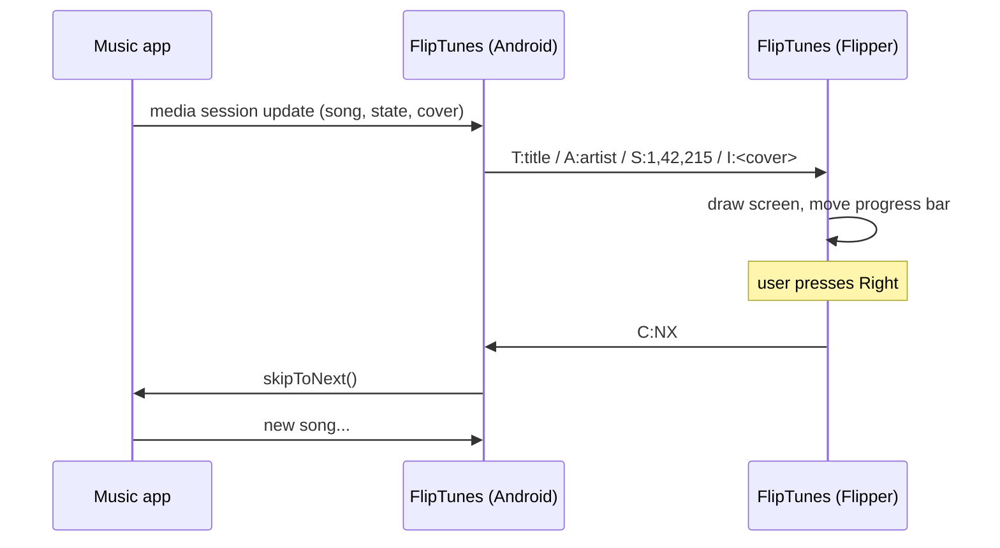

# How FlipTunes works

A walkthrough of the whole project, for anyone who wants to learn from it, fork it or build
something similar. No prior Flipper or Android experience assumed.

## The big picture



Two small apps, one text-based conversation over Bluetooth Low Energy (BLE).

---

## Part 1 - The Android app

### 1. Finding out what's playing (`MediaWatcher.kt`)

Every modern music app publishes a **media session**: the same info your lock screen and
earbuds use. Android only lets other apps read it if the user grants **Notification access**,
so the app includes an empty `NotificationListenerService` purely to hold that permission.

`MediaSessionManager.getActiveSessions()` returns every session; FlipTunes picks the one that's
playing (or the most recent), reads title, artist, duration and cover from its `MediaMetadata`,
and the position from its `PlaybackState`.

Apps only report the position now and then, so the current position is *estimated*:

```
position = last reported position + (time since that report x playback speed)
```

Controls use the same session: `transportControls.play()`, `pause()`, `skipToNext()`, `seekTo()`.

### 2. Talking to the Flipper (`FlipperLink.kt`)

The Flipper already has a Bluetooth **serial service** (normally used by the official mobile app).
FlipTunes connects to it as a BLE client:

1. `connectGatt()` to the chosen Flipper
2. ask for a bigger packet size (`requestMtu(247)`) so messages need fewer chunks
3. discover services, find the serial RX and TX characteristics
4. enable **indications** on TX so the Flipper can send button presses back
5. write outgoing text to RX, one chunk at a time (BLE allows one write in flight)

If the link drops, it retries every 5 seconds.

### 3. Album art for a 1-bit screen (`ArtEncoder.kt`)

The Flipper's screen is 128x64 pixels and every pixel is either on or off. Converting a colour
cover:

1. centre-crop to a square, shrink to **48x48**
2. convert to brightness and **stretch the contrast** so dark covers keep detail
3. **Floyd-Steinberg dithering**: round each pixel to black or white and pass the rounding
   error on to its neighbours (7/16 right, 3/16 down-left, 5/16 down, 1/16 down-right).
   Patterns of dots then fake grey shades - the same trick newspapers use.
4. pack 8 pixels per byte (XBM format, which the Flipper draws natively) = 288 bytes
5. send as base64 text: `I:AAAA...`

### 4. Feeling the beat (`BeatDetector.kt`)

Sending every detected kick over Bluetooth makes flashes late and uneven, because Bluetooth
delay varies. FlipTunes instead works out the **tempo** and lets the Flipper keep time itself.

1. **Listen** - Android's `Visualizer` gives a frequency snapshot of the phone's audio output
   about 20 times a second.
2. **Onsets** - for the bass frequencies (~40-350 Hz), add up how much each got louder since the
   last snapshot (*spectral flux*). A value well above the recent average is a kick. The
   threshold adapts to the song's loudness; the sensitivity setting changes how far above.
3. **Tempo** - collect the gaps between kicks over the last 8 seconds into a histogram
   (60-180 BPM). The tallest bar is the beat period.
4. **Phase** - place every kick on a circle of one beat period and average them: that tells
   *where* in the period the beats fall.
5. **Send** `M:<period>,<ms to next beat>` once a second. If there's no steady beat (ambient
   music, speech), raw kicks (`B`) are sent instead.

---

## Part 2 - The Flipper app (`flipper/fliptunes.c`)

A single C file built with **ufbt**. The main pieces:

| Piece | What it does |
|---|---|
| `bt_profile_start(..., ble_profile_serial, ...)` | Restarts Bluetooth in serial mode and gives the app a handle to it |
| `claim_serial()` | When a phone connects, the firmware hands the serial link to its RPC system (for the official app). FlipTunes takes it back with `ble_profile_serial_set_event_callback` |
| `serial_callback()` | Runs on the Bluetooth thread: copies incoming bytes into a stream buffer and returns immediately |
| `drain_rx()` / `handle_line()` | Main loop: splits bytes into lines and updates the state |
| `draw_callback()` | Draws album art (`canvas_draw_xbm`), scrolling text (`elements_scrollable_text_line`) and the progress bar |
| Metronome | Every 10 ms checks if the next beat time has come and flashes the LED, so Bluetooth timing doesn't matter |
| Settings | Saved with `saved_struct_save` to `/ext/apps_data/fliptunes/` |

**Threads and safety.** Bluetooth callbacks, the GUI and the main loop run on different threads.
All shared state is protected by one mutex, and callbacks never block - a lesson learned the hard
way: an early version blocked the GUI thread while waiting for Bluetooth, freezing the Flipper.

**Gotcha worth knowing:** in Flipper firmware 1.x, `ble_gatt_characteristic_update()` returns
`true` on *failure*. Don't use its return value to report errors.

---

## Ideas for contributions

- Up-next track and shuffle/repeat toggles
- Phone battery and clock on the Flipper
- iPhone support (iOS exposes now-playing to BLE accessories via Apple Media Service)
- Transliteration for more scripts instead of `?`
